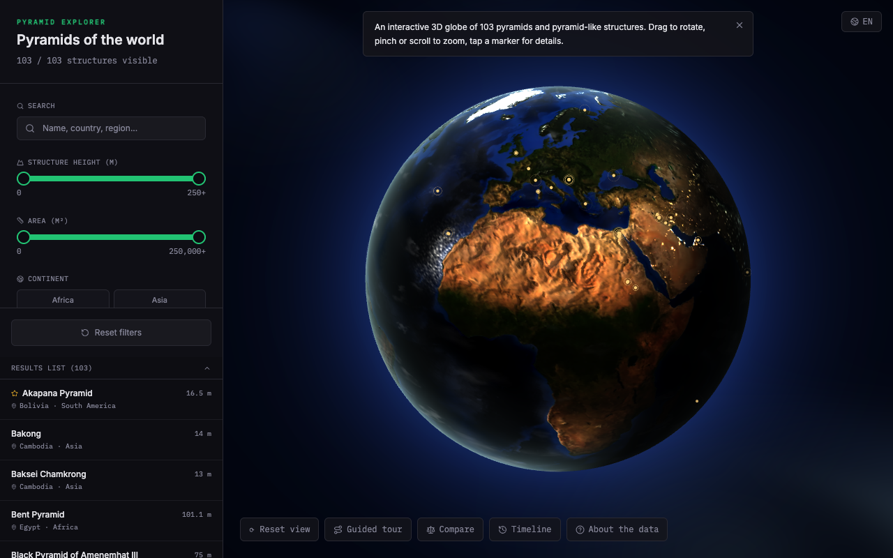
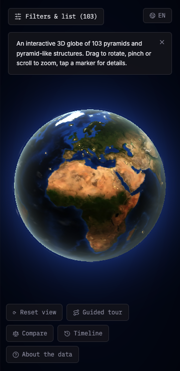

# Pyramid Explorer

An interactive 3D globe of 103 pyramids and pyramid-like structures: Egypt, Sudan, Mesoamerica, the Andes, China, Southeast Asia, Europe and the Pacific. Pick a pin to see dimensions, dating, function, local legends, photos and sources. Every site shows how well its data is sourced, and alternative claims are kept apart from mainstream archaeology.

Live: https://pyramid-explorer-global.vercel.app

| Desktop | Mobile |
| --- | --- |
|  |  |

## Features

- A planet globe in three.js with clickable pins, drag, pinch and scroll zoom. A static picture paints first; the 3D scene starts after it and lowers its quality on slow devices.
- Filters by continent, civilization, period, height, area, free text, verification and contested status, with sorting.
- Compare sites at the same scale, follow a timeline, or take a guided tour.
- Photo gallery from Wikimedia Commons on 93 sites, with author and licence next to every photo.
- 360° panoramas from Commons for a few sites, and schematic 3D models of five Egyptian pyramids built only from sourced measurements.
- Shareable URLs for sites, filters and comparisons; a prerendered page per site and a sitemap.
- Six languages for the interface and the site texts: English, Italian, Spanish, French, German, Portuguese.
- Works on phones: the site card covers half the screen so the site stays visible on the globe.
- Keyboard and screen reader support in the dialogs, and `prefers-reduced-motion` is respected.
- No WebGL? A flat world map with the same pins is shown instead.

## Data

The dataset is `src/data/pyramids.json`. Each value either has a source or is listed in the site's `campi_senza_fonte` and marked as unsourced in the interface; nothing is estimated. [The data audit](docs/DATA_AUDIT.md) lists the sources, the corrections and the remaining gaps, with a coverage report generated from the data.

## Stack

React 18, TypeScript, Vite, Tailwind CSS, Radix, three.js, Vitest and Testing Library. Static site with no backend, hosted on Vercel.

## Run locally

```bash
bun install --frozen-lockfile
bun run dev      # http://localhost:8080
bun run test
bun run build    # also prerenders /site/<id> pages and the sitemap
bun run audit    # refreshes the coverage report in docs/DATA_AUDIT.md
```

Vite needs Node 20.19 or later. The planet's textures and mesh are served from Vercel Blob; to work offline, copy them to `public/planet` and set `VITE_PLANET_ASSETS=/planet` in `.env.local`.

## Project status

Personal project: see [the roadmap](docs/ROADMAP.md) and [the photo and 360° notes](docs/PHOTO_EXPERIENCE.md).
